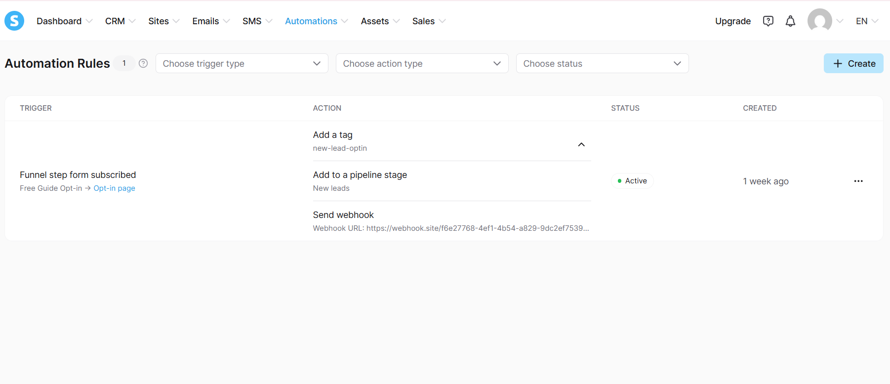
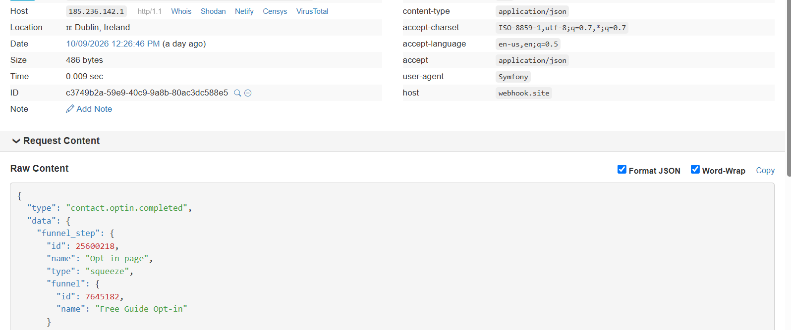
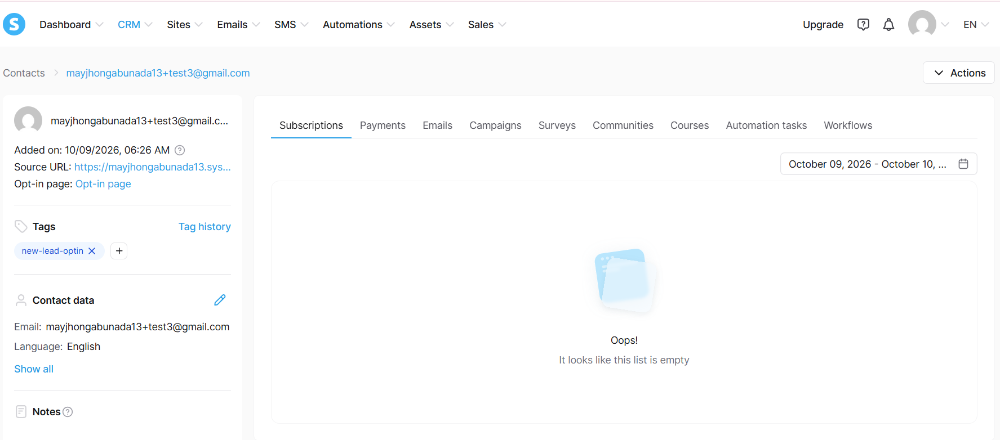
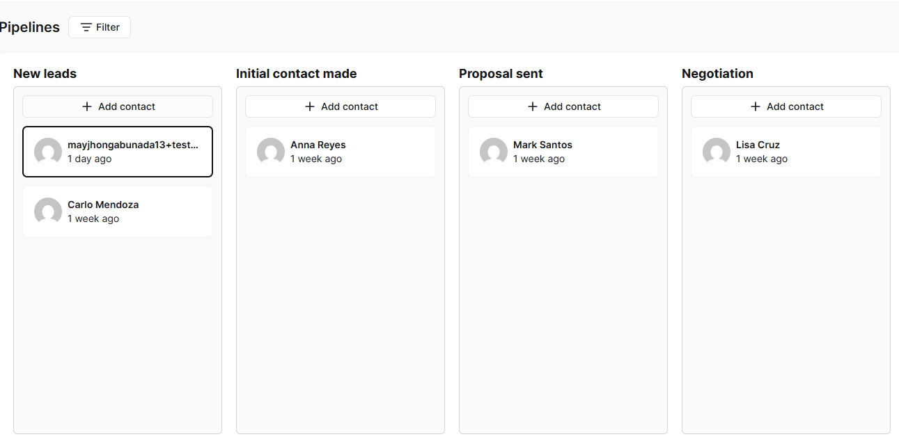
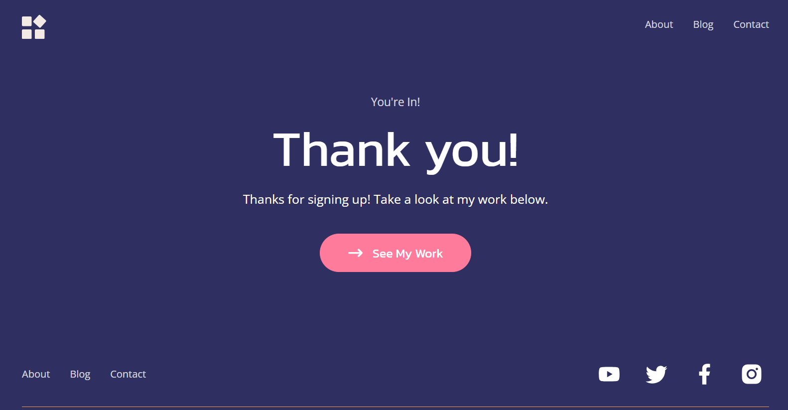

# Lead Automation Workflow: Tag, Pipeline & Webhook

A practice project built in Systeme.io. It extends my [lead capture funnel](https://mayjhongabunada13.systeme.io/free-guide): when a visitor submits the opt-in form, one automation rule runs three actions without any manual step.

This is a learning project, built with my own test contacts. It is not client work.

## What it does

```
Opt-in form submitted
        |
        v
Automation rule (trigger: funnel step form subscribed)
        |
        +--> 1. Add tag             new-lead-optin
        +--> 2. Add to pipeline     Web Services Sales -> "New leads"
        +--> 3. Send webhook        POST (JSON) to an external endpoint
```

## Screenshots

### 1. The automation rule
One trigger and three actions, all in a single rule.



### 2. The webhook request received
After a test signup, the endpoint (webhook.site) received a `POST` with the event type `contact.optin.completed`, the funnel details, and the contact data.



### 3. The tagged contact
The test contact was created from the form and tagged `new-lead-optin` automatically.



### 4. The pipeline
The same contact appeared in the "New leads" stage of the six-stage sales pipeline.



### 5. The thank-you page
The page the visitor lands on after signing up, linking back to this portfolio.



## The webhook payload

This is the JSON the endpoint received after a test signup. The IP address and the account email are replaced with `[hidden]`.

```json
{
  "type": "contact.optin.completed",
  "data": {
    "funnel_step": {
      "id": 25600218,
      "name": "Opt-in page",
      "type": "squeeze",
      "funnel": {
        "id": 7645182,
        "name": "Free Guide Opt-in"
      }
    },
    "contact": {
      "referred_by_contact_id": null,
      "referred_by_contact_email": null,
      "id": 447592083,
      "email": "mayjhongabunada13+test3@gmail.com",
      "fields": [],
      "ip": "[hidden]"
    },
    "source_url": "https://mayjhongabunada13.systeme.io/free-guide"
  },
  "account": {
    "email": "[hidden]"
  },
  "created_at": "2026-10-09T04:26:45+00:00"
}
```

## What I learned

- How event-driven automations connect a form, a CRM, and an outside system.
- How a webhook payload is structured, and how to inspect one with a test endpoint.
- How to work within free-plan limits: the plan allows one automation rule, so I combined all three actions into a single rule instead of creating separate ones.
- Why a welcome email did not send on the free plan: Gmail addresses need domain authentication (SPF/DKIM). I changed the thank-you page text so it no longer promises an email.

## Tools

Systeme.io (funnels, CRM, automation rules, pipelines), webhooks (JSON over POST), webhook.site for testing.

The same trigger, action, and webhook pattern is used in GoHighLevel workflows, which I am learning next.
